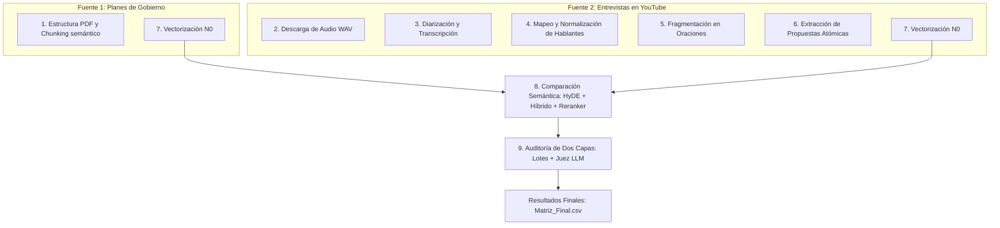

# Resumen Ejecutivo: Pipeline de Análisis Político y Auditoría RAG

Este documento ofrece un vistazo general, resumido y secuencial del flujo de procesamiento implementado en el proyecto. El objetivo del pipeline es contrastar de manera automatizada y con rigor científico las declaraciones públicas hechas por los candidatos presidenciales peruanos en televisión frente a sus planes de gobierno oficiales, detectando equivalencias lógicas, contradicciones, falsas equivalencias y omisiones (novedades).

---

## Estructura General del Flujo (Pipeline de 9 Pasos)

---

## Síntesis Paso a Paso

### 1. Chunking de Planes de Gobierno (Paso 1 del Notebook)
* **Objetivo:** Segmentar y enriquecer los planes de gobierno en PDF.
* **Proceso:** Extrae la estructura jerárquica con el modelo de visión Docling (desactivando OCR y aislando páginas corruptas en `Errores_OCR`). Luego, utiliza un LLM local (`gpt-oss-20b` con validación estricta de Pydantic y reintentos) para generar propuestas independientes normalizadas, clasificándolas en tópicos y tonos.
* **Entrada:** `Planes/*.pdf`
* **Salida:** `Resultados/Chunks/*.json`

### 2. Descarga de Entrevistas (Paso 1 de YT en el Notebook)
* **Objetivo:** Obtener las entrevistas en video en formato de audio de alta calidad.
* **Proceso:** Lee un archivo de control de enlaces en Excel y descarga los audios como archivos sin compresión `.wav` usando `yt_dlp` y postprocesadores FFmpeg, bajo nombres estructurados `{ID}_{CID}_{nombreF}.wav`.
* **Entrada:** `Discursos/Links.xlsx`
* **Salida:** `Resultados/Audios/*.wav`

### 3. Diarización y Transcripción con WhisperX (Paso 2 de YT en el Notebook)
* **Objetivo:** Transcribir el audio dividiendo el texto según los turnos de habla de los locutores.
* **Proceso:** Libera la VRAM de modelos previos. Ejecuta WhisperX (modelo `large-v3`, GPU `batch_size=64`, precisión `float16`) combinado con el modelo de diarización de HuggingFace `pyannote/speaker-diarization-3.1` para aislar los turnos de habla.
* **Entrada:** `Resultados/Audios/*.wav`
* **Salida:** `Resultados/Diario/*.json` (JSONs con segmentos de tiempo y etiquetas SPEAKER_XX).

### 4. Identificación y Normalización de Hablantes (Paso 3 de YT en el Notebook)
* **Objetivo:** Mapear quién es quién y etiquetar de forma definitiva al candidato foco de la entrevista.
* **Proceso:** Fusiona de forma determinista los turnos de habla continuos del mismo locutor. Envía los primeros 60 turnos al LLM para deducir quién es cada `SPEAKER_XX` y añade la columna `Es_Candidato` (1 o 0) aplicando comparación difusa inteligente (`difflib` con umbral del 75%) y normalización Unicode.
* **Entrada:** `Resultados/Diario/*.json`, `Discursos/Links.xlsx`
* **Salida:** `Resultados/Consolidado/*.csv`

### 5. Fragmentación de Intervenciones en Oraciones (Paso 4 de YT en el Notebook)
* **Objetivo:** Dividir los textos extensos del candidato en oraciones agrupadas por coherencia de idea.
* **Proceso:** Aplica tokenización sintáctica NLTK en español. Mediante una ventana deslizable dinámica (lookahead buffer de 5 a 12 oraciones) y llamadas al LLM local, segmenta el texto donde termina cada idea específica, generando de forma obligatoria una nota de contexto para resolver sujetos tácitos.
* **Entrada:** `Resultados/Consolidado/*.csv`
* **Salida:** `Resultados/Fragmentos/*_fragmentos.json`

### 6. Extracción de Propuestas Atómicas (Paso 5 de YT en el Notebook)
* **Objetivo:** Filtrar anécdotas y retórica y extraer propuestas políticas de acción estatales.
* **Proceso:** El LLM extrae la propuesta atómica (`raw_text` literal y `normalized_text` en tercera persona). Si no posee propuestas (anécdotas, quejas, saludos), es catalogado como ruido y enviado a `Descartados/`. Realiza una alineación por Fuzzy Matching para que el `raw_text` coincida con la transcripción original exacta.
* **Entrada:** `Resultados/Fragmentos/*_fragmentos.json`
* **Salida:** `Resultados/Atomico/*.json` (Válidas) y `Descartados/*.json` (Rechazadas).

### 7. Vectorización de Propuestas (Paso 6 del Notebook)
* **Objetivo:** Generar representaciones matemáticas densas (embeddings) de las propuestas.
* **Proceso:** Para ambos conjuntos de datos, utiliza la estrategia de **Contexto N0 (Atómico)**, extrayendo y vectorizando de manera aislada el texto normalizado (`normalized_text`) de cada propuesta con el modelo Qwen en LM Studio. Esto evita el sesgo de arrastre de propuestas adyacentes y mejora la fidelidad del emparejamiento posterior.
* **Entrada:** `Resultados/Atomico/*.json` y `Resultados/Chunks/*.json`
* **Salida:** Mismos archivos con vectores de 4096 dimensiones integrados.

### 8. Comparación Semántica (Paso 7 del Notebook)
* **Objetivo:** Recuperar las propuestas del plan de gobierno más coherentes con el discurso.
* **Proceso:** Aplica expansión HyDE (documento hipotético simulando un plan formal) y extrae variaciones. Luego ejecuta una búsqueda híbrida fusionada (`score_semantico * 0.70` + `score_lexico_normalizado * 0.30`) usando similitud coseno y Okapi BM25. Finalmente aplica Reranking con un Cross-Encoder local (`jina-reranker-v2`) en la GPU y ensambla la matriz resolviendo contextos amplios.
* **Entrada:** `Resultados/Atomico/*.json` y `Resultados/Chunks/*.json`
* **Salida:** `Resultados/Matriz.csv`

### 9. Validación y Auditoría con LLM (Paso 8 del Notebook)
* **Objetivo:** Auditar la relación lógica entre el discurso oral y la propuesta escrita.
* **Proceso:** Prepara y recorta los contextos (Plan máx 2500, Entrevista máx 2000 caracteres) alrededor de la propuesta para evitar desbordamiento de ventana. Ejecuta inferencias individuales uno a uno (Etapa 8A) categorizando en Equivalencia, Contradicción, Falsa Equivalencia o Novedad. Luego, mediante un Motor de Reglas de dominancia lógica secuencial y un Juez LLM (Etapa 8B), consolida el veredicto definitivo.
* **Entrada:** `Resultados/Matriz.csv`
* **Salida:** `Resultados/Matriz_Final.csv`
