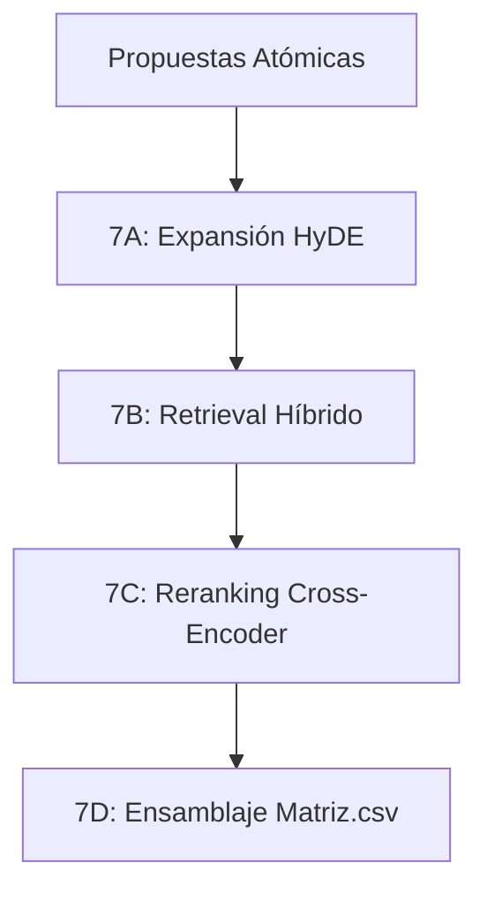

# Paso 8: Comparación Semántica (HyDE + RAG Híbrido + Cross-Reranker)

Este paso implementa la arquitectura de recuperación (retrieval) RAG avanzada del proyecto, encargada de emparejar cada propuesta atómica oral extraída de las entrevistas contra las propuestas correspondientes del plan de gobierno oficial del respectivo candidato.

---

## Módulos del Paso 7 (Notebook)
El proceso se divide secuencialmente en 4 sub-etapas altamente optimizadas para garantizar precisión léxica y semántica:

---

## 1. Etapa 7A: Precomputación de Queries (HyDE + Vectorización)
* **Módulo asociado:** [comparacion_etapa_a.py](file:///c:/Users/Usuario/Desktop/CandiFinal/common/comparacion_etapa_a.py)
* **Salida:** `Resultados/Intermedios/queries_precomputadas.json`

### Metodología
1. **Expansión HyDE (Hypothetical Document Embeddings):** Los discursos políticos en entrevistas suelen ser conversacionales e informales. Para alinearlos con la redacción formal de los planes de gobierno, el LLM local (`gpt-oss-20b` con `temperature = 0.7`) genera un "documento hipotético" (HyDE) que simula cómo se redactaría técnicamente dicha propuesta en un documento oficial (ej. transformando "ayudar a los niños" en "programa de nutrición infantil mediante transferencias condicionadas").
2. **Variaciones Léxicas:** El LLM extrae adicionalmente 3 términos técnicos y sectoriales asociados con el área de la propuesta para robustecer la indexación por palabras clave.
3. **Vectorización:** Se genera y almacena el embedding vectorial del documento HyDE (`vector_hyde`) a través de LM Studio.
4. **Checkpointing:** Se guardan los resultados incrementalmente cada 10 registros para permitir la reanudación del proceso ante fallas.

---

## 2. Etapa 7B: Retrieval Híbrido (Coseno + BM25 Okapi)
* **Módulo asociado:** [comparacion_etapa_b.py](file:///c:/Users/Usuario/Desktop/CandiFinal/common/comparacion_etapa_b.py)
* **Salida:** `Resultados/Intermedios/pool_candidatos.json`

### Metodología
1. **Base de Datos en Memoria (`PlanDatabase`):** Carga los chunks vectorizados de todos los planes de gobierno y construye dinámicamente un índice de recuperación léxica BM25 (`BM25Okapi`) para cada candidato.
2. **Búsqueda en Dos Cadenas:**
   * **Rama Semántica (Coseno):** Calcula la similitud coseno entre el `vector_hyde` de la query y todos los vectores de los chunks del plan del candidato correspondiente.
   * **Rama Léxica (BM25):** Calcula la puntuación Okapi BM25 basándose en la concatenación de la consulta original, el documento hipotético HyDE y las variaciones de vocabulario técnico.
3. **Fusión Híbrida de Scores:** Se unifican las puntuaciones normalizando el score BM25 (dividiéndolo por `normalizador_bm25 = 15.0`) y aplicando pesos específicos:
   $$\text{Score Híbrido} = (\text{Score Semántico} \times 0.70) + (\text{Score BM25 Normalizado} \times 0.30)$$
4. **Filtrado Top-K:** Se selecciona el pool de los mejores $K=10$ candidatos recuperados.

---

## 3. Etapa 7C: Reranking con Cross-Encoder local (Jina v2)
* **Módulo asociado:** [comparacion_etapa_c.py](file:///c:/Users/Usuario/Desktop/CandiFinal/common/comparacion_etapa_c.py)
* **Salida:** `Resultados/Intermedios/pool_rerankeado.json`

### Metodología
1. **Liberación de Memoria:** Se purga la VRAM descargando los modelos activos de LM Studio y vaciando el caché de PyTorch en la GPU Blackwell (`torch.cuda.empty_cache()`).
2. **Inferencia con Cross-Encoder:** Se carga un modelo local especializado en atención cruzada (`jina-reranker-v2`). A diferencia de los embeddings normales (Bi-Encoders), el Cross-Encoder evalúa conjuntamente pares de `[Texto Query, Texto Plan]` permitiendo que las capas de atención calculen dependencias lingüísticas completas entre ambos textos.
3. **Re-ordenamiento:** Las propuestas se ordenan en orden descendente según su `score_reranker`, actualizando sus posiciones jerárquicas (ranks).

---

## 4. Etapa 7D: Ensamblaje de Matriz.csv
* **Módulo asociado:** [comparacion_nueva.py](file:///c:/Users/Usuario/Desktop/CandiFinal/common/comparacion_nueva.py)
* **Salida final:** `Resultados/Matriz.csv`

### Metodología
Ensambla y enriquece la información unificándola en una matriz estructurada, resolviendo los contextos:
* **Contexto Oral Amplio (N0):** Extrae la intervención oral completa original del candidato desde los archivos de `Resultados/Consolidado/`.
* **Contexto del Plan de Gobierno (N1):** Para evitar la pérdida de sentido debida al chunking, se extrae el texto del bloque seleccionado junto con los bloques adyacentes anterior (`B-1`) y posterior (`B+1`), eliminando marcas de tablas markdown y uniéndolos mediante la notación `" [...] "`.
* **Clasificación de Score:** Clasifica de forma referencial el nivel del match en `ALTO`, `MEDIO` o `BAJO` de acuerdo con umbrales fijos (e.g. en modo Reranker: ALTO $\ge 0.60$, MEDIO $\ge 0.30$, BAJO $< 0.30$).
* Guarda el resultado ordenado jerárquicamente en formato CSV con codificación `utf-8-sig`.
