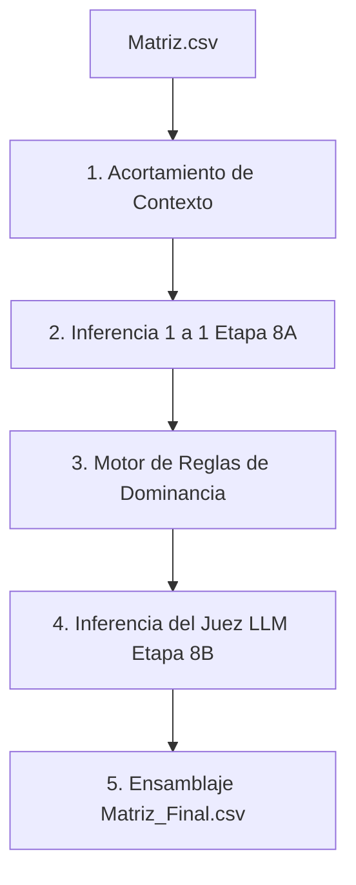

# Paso 9: Validación y Auditoría de Dos Capas con Juez LLM

> [!NOTE]
> En el archivo de control principal [main.ipynb](file:///c:/Users/Usuario/Desktop/CandiFinal/main.ipynb), este paso está numerado y etiquetado como el **Paso 8: Validar con LLM** debido a la división de la Fuente 1 en sub-pasos (1a y 1b). En esta documentación lineal, corresponde a la novena etapa del flujo.

Este paso implementa un sistema híbrido de dos capas (auditoría uno a uno de primer nivel + motor de reglas y Juez LLM consolidador) encargado de validar el rigor lógico de las equivalencias propuestas por el RAG, contrastando y evaluando la veracidad de las afirmaciones hechas por los candidatos en televisión frente a sus planes oficiales.

---

## Metodología y Flujo de Trabajo
* **Módulos y funciones asociados:**
  * [validador_etapa_a.py](file:///c:/Users/Usuario/Desktop/CandiFinal/common/validador_etapa_a.py):
    * Preparación unificada: `preparar_datos_y_csv_validacion()`
    * Inferencia individual: `evaluar_lotes()`
  * [validador_etapa_b.py](file:///c:/Users/Usuario/Desktop/CandiFinal/common/validador_etapa_b.py):
    * Motor de reglas y Juez LLM: `consolidar_veredictos()`
  * [validador_nuevo.py](file:///c:/Users/Usuario/Desktop/CandiFinal/common/validador_nuevo.py):
    * Orquestador principal: `aplicar_validacion_llm_nueva()`
* **Entrada:** Matriz de similitud semántica en `Resultados/Matriz.csv`.
* **Salida Final:** Matriz consolidada y auditada en `Resultados/Matriz_Final.csv`.

---

## Fases Algorítmicas del Proceso

### 1. Preparación de Datos y Acortamiento de Contextos
Antes de realizar inferencias, el módulo previene desbordamientos de ventana de contexto en el LLM y loops infinitos aplicando limpieza y recortes a través de `preparar_datos_y_csv_validacion()`:
* **Limpieza:** Se eliminan caracteres invisibles y formato de tablas markdown (`_limpiar_texto`).
* **Acortamiento Robusto:** Usando `_robust_find` y `_acortar_contexto`, se localizan las propuestas dentro de sus bloques y se recorta el texto circundante centrándolo en la propuesta (Plan: máximo 2500 caracteres, Entrevistas: máximo 2000 caracteres), añadiendo la marca `"..."` en los límites. Esto conserva el contexto temático relevante consumiendo la mínima cantidad de tokens.
* **Archivos intermedios:** Los datos se unifican en `Resultados/Intermedios/matriz_preparada.csv` (para diagnóstico y auditoría manual) y `Resultados/Intermedios/matriz_preparada_Matriz.json` (para consumo en la inferencia por lotes).

### 2. Etapa 8A: Inferencia Individual Uno a Uno
Se evalúa la coherencia entre la entrevista y cada match de plan de gobierno de forma individual usando el LLM local (`gpt-oss-20b` con `temperature = 0.05`):
* **Relación Lógica (Taxonomía):**
  * `EQUIVALENCIA`: Proponen la misma acción o mecanismo de reforma específica.
  * `CONTRADICCION`: Lo afirmado por el candidato choca o se opone directamente al plan.
  * `FALSA_EQUIVALENCIA`: El plan menciona lineamientos muy abstractos y generales del tema, pero el candidato los usa en TV para adjudicarse falsamente una propuesta concreta que NO está escrita ni sugerida (demagogia electoral).
  * `NOVEDAD_ABSOLUTA`: El tema no existe en el plan de gobierno o no guarda ninguna relación.
* **Delta de Detalle:** Clasifica el nivel de asimetría informativa en `ENTREVISTA_MAS_DETALLADA`, `PLAN_MAS_DETALLADO` o `DETALLE_SIMILAR`.
* Los resultados de cada par se guardan en `Resultados/Intermedios/evaluaciones_lotes.json` bajo checkpoints incrementales.

### 3. Etapa 8B: Motor de Reglas y Juez LLM
Para emitir un dictamen definitivo unificado por consulta (ya que una propuesta oral se compara contra múltiples candidatos del plan), se aplica una arquitectura de **Motor de Reglas + Juez LLM**:
1. **Dominancia Secuencial por Capas (Reglas):**
   * **Capa de Contradicción:** Si en el paso anterior algún candidato fue evaluado como `CONTRADICCION`, el motor prioriza estas propuestas y las envía al Juez LLM. Si el juez las ratifica, el veredicto final de la consulta se fija de inmediato en `CONTRADICCION`.
   * **Capa de Equivalencia:** Si no hay contradicciones confirmadas pero sí matches de `EQUIVALENCIA`, se priorizan y envían al Juez para su ratificación.
   * **Capa de Falsa Equivalencia:** Si la mayoría matemática de los matches son calificados como `FALSA_EQUIVALENCIA`, se evalúa esta categoría prioritariamente ante el Juez.
   * **Capa de Novedad:** Si el retrieval matemático arrojó `SIN_MATCH`, se asigna de forma directa `NOVEDAD_ABSOLUTA` y se vacía el listado de chunks responsables.
2. **Inferencia del Juez LLM:** El Juez evalúa las propuestas pre-seleccionadas y emite un JSON estructurado con:
   * Las `etiquetas_justificantes` (ej. `[Propuesta 1]`) del plan que causan el veredicto.
   * La relación lógica y delta de detalle consolidados.
   * Una justificación general y comentarios individuales.
3. **Consistencia Lógica:** Si el veredicto final consolidado es `CONTRADICCION` o `NOVEDAD_ABSOLUTA`, la asimetría de detalle se fuerza a ser `NO_APLICA`.
4. **Mapeo de Retorno:** Se traducen las etiquetas abstractas del Juez a los IDs reales de los chunks del plan.

### 4. Ensamblaje Final de la Matriz Final
El script `validador_nuevo.py` unifica la matriz inicial con los veredictos consolidados:
* En caso de equivalencias o contradicciones fundamentadas en múltiples fragmentos, concatena sus identificadores en `ID_Plan_Gobierno` separados por coma, e integra de forma secuencial sus textos normalizados (unidos por `" | "`) y contextos (unidos por `" [...] "`).
* Los datos resultantes se ordenan de forma trazable por candidato e identificador de entrevista, y se guardan en `Resultados/Matriz_Final.csv` utilizando codificación `utf-8-sig`.
* El paso imprime en consola estadísticas sobre la distribución de las relaciones lógicas y delta de detalle detectados.
